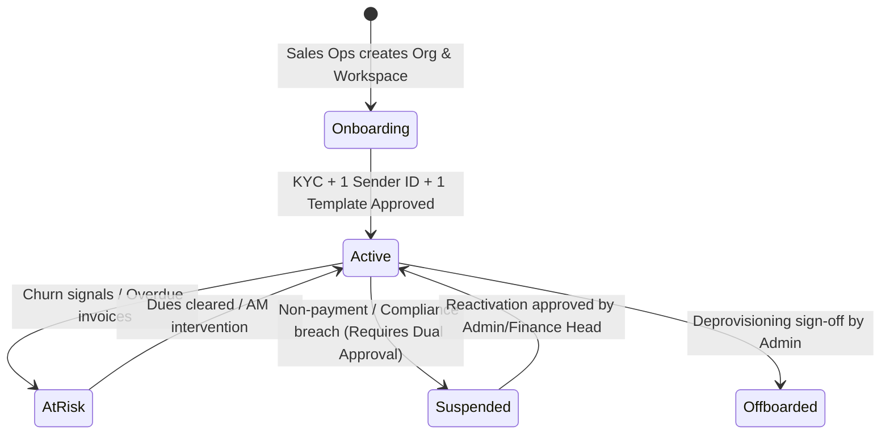

# Relay BMP - Comprehensive End-to-End QA & Verification Test Plan

This document serves as the master test protocol for **Relay Billing & Provisioning Platform (BMP)**, an internal enterprise CPaaS management system built for Indian telecom compliance, credit underwriting, and lifecycle orchestration.

---

## 1. Test Environment & Initial State

- **Application URL**: `http://localhost:3000`
- **Database Engine**: SQLite with Drizzle ORM (`relay.db`)
- **Seeded Dataset**:
  - 42 Organizations (23 Prepaid, 19 Postpaid)
  - 58 Workspaces
  - 418 Workspace Users across seat tiers
  - 5,220 Daily Usage records (90 days of traffic)
  - 99 Invoices (including overdue & disputed)
  - 140 Tickets, 6 KYC Cases, 5 Sender IDs, 8 DLT Templates
  - 42 Cryptographically Chained Audit Entries
- **Demo Reset Command**: `npm run seed:reset` or TopBar **"Reset Demo Data"** (Admin only).

---

## 2. Test Suite 1: Role Switcher & Security Enforcement

Relay BMP features demo-friendly instant role-switching via the top-bar dropdown. Evaluators can "Act as" any seeded user with zero credential friction. The session is stored in the `relay_actor_id` cookie.

### 2.1 Role Matrix Inspection (`/roles`)
Navigate to `/roles` as **Admin (Kabir Anand)** to inspect the complete 33-permission matrix.

| Role | Primary Persona | Visible UI Modules | Forbidden Actions (Server-Enforced) |
|---|---|---|---|
| **Account Manager (AM)** | Ananya Sen | Accounts (Portfolio), Tasks, Tickets, QBR Briefs | Cannot see bank financials, cannot modify credit limits directly, cannot approve discounts > 10% |
| **Support** | Rahul Verma | Limited Accounts 360, Tickets, Password/Seat resets | **Never sees money**: credit limits, wallet balances, invoices, and rate cards are completely hidden |
| **Finance** | Rohan Joshi | Finance Hub, Invoices, Top-ups, Adjustments, Aging | Cannot approve credit increases > ₹5L or adjustments > ₹50,000 without Head approval |
| **Sales Ops** | Priya Mehta | Accounts Wizard (`/accounts/new`), Plans Catalog (`/plans`), Add-ons | Cannot approve KYC documents; cannot approve credit adjustments |
| **Compliance** | Kavita Nair | Compliance Hub (`/compliance`), KYC, Sender IDs, Templates | Cannot edit rate cards, plan tiers, or credit lines |
| **Finance Head** | Deepak Chopra | Finance Hub, Approvals Queue (`/approvals`), Risk Thresholds | Second-person approver for high-value credit, overdue overrides, and write-offs |
| **Admin** | Kabir Anand | Full platform access, System Audit (`/audit`), AI Telemetry (`/admin/ai`), Reset Demo Data | Cannot approve own change requests (Maker-Checker enforced) |

### 2.2 Server Enforcement & Denied Audit Log Verification
1. Switch role to **Support (Rahul Verma)** in the top bar.
2. Attempt to invoke a forbidden server action (e.g., credit limit change or plan update).
3. **Expected Result**:
   - The action throws an immediate `Forbidden` exception.
   - An immutable audit entry is appended to `audit_log` with `action: "permission_denied"`, `is_denied: 1`, and the user's IP.
   - Switch to **Compliance (Kavita Nair)** or **Admin (Kabir Anand)**, navigate to `/audit`, click the **"Denied attempts"** filter tab, and verify that the red **"Denied Attempt"** chip appears with the exact timestamp and forbidden action.

---

## 3. Test Suite 2: Full Account Lifecycle State Machine

Test the end-to-end customer journey from initial onboarding to contract offboarding.



### 3.1 Step 1: Create Organization & Workspace (`/accounts/new`)
1. Switch role to **Sales Ops (Priya Mehta)**.
2. Navigate to `/accounts/new` to open the 5-step onboarding wizard:
   - **Step 1: Org details**: Legal Name: `Apex Pay India Private Limited`, Industry: `Fintech`, City: `Mumbai`, Billing Model: `Postpaid`.
   - **Step 2: Workspace**: Name: `Core Payments API`, GSTIN: `27AAACA9999P1Z5` (Validated Maharashtra GSTIN), Billing State: `Maharashtra`.
   - **Step 3: Plan & Pricing**: Select `Growth` plan. Input 5% discount with reason: `Promotional launch tier`.
   - **Step 4: Owner Invite**: Name: `Nikhil Sharma`, Email: `nikhil@apexpay.in`.
   - **Step 5: Review & Create**: Verify effective rates and submit.
3. **Verification**:
   - Organization is created with status `onboarding`.
   - Workspace is created with status `kyc_pending`.
   - On the Account 360 Overview tab, the **Onboarding Checklist** appears with steps clearly flagged.

### 3.2 Step 2: Regulatory Prerequisite Enforcement
1. While still in `onboarding`, attempt to set status to `active` via quick actions.
2. **Verification**: System rejects the transition with:
   > *"Cannot activate account: Mandatory regulatory prerequisites missing. At least one verified KYC case, one approved DLT sender ID, and one approved message template are required before activation."*

### 3.3 Step 3: Compliance Approvals (`/compliance`)
1. Switch role to **Compliance (Kavita Nair)**.
2. Navigate to `/compliance`:
   - **KYC**: Find the submission for `Apex Pay India`, review documents, and click **"Approve KYC"**. Workspace moves from `kyc_pending` to `active`.
   - **DLT Sender ID**: In the Headers tab, approve `APEXP` for SMS transactional traffic.
   - **Message Template**: In the Templates tab, approve `APEX_OTP` with TRAI Registration ID `110716182910283`.

### 3.4 Step 4: Go-Live Activation & Account Management
1. Navigate to `/accounts/org_apexpayindia...`.
2. Click **"Activate Account"**. Status transitions to `active`.
3. In **Plan tab**: Change plan to `Scale` or attach an add-on (e.g., `Dedicated IP` or `TPS Booster 50 MPS`).
4. Verify bill impact projection calculates correctly against 30-day usage.

### 3.5 Step 5: Suspension, Reactivation & Offboarding
1. Click **"Suspend Account"**: Select reason `compliance_violation` or `non_payment`.
2. Because outstanding postpaid balances trigger maker-checker rules, a change request is created.
3. Switch to **Finance Head (Deepak Chopra)** or **Admin**, go to `/approvals`, and approve suspension. Account status updates to `suspended`.
4. Click **"Reactivate Account"**, approve the change request $\rightarrow$ status returns to `active`.
5. Click **"Offboard Account"** with reason: `Contract end de-provisioning` $\rightarrow$ status moves to `offboarded`.

---

## 4. Test Suite 3: Maker-Checker Dual Approval Engine

BMP mandates that critical financial, contractual, and operational changes require two distinct pairs of eyes.

### 4.1 Test Scenarios & Routing Rules

| Action | Threshold | Maker Role | Checker Role | Self-Approval Allowed? |
|---|---|---|---|---|
| **Credit Limit Hike** | Hike > ₹5,00,000 OR > 25% | AM / Finance | Finance Head | **NO (Blocked)** |
| **Credit Hike with Overdue** | Workspace has overdue invoices | Any | Finance Head | **NO (Blocked)** |
| **Credit Limit Below Used** | New limit < utilized credit | Any | Finance Head | **NO (Blocked)** |
| **Manual Adjustment** | Amount > ₹50,000 | Finance | Finance Head | **NO (Blocked)** |
| **Commercial Discount** | Discount > 15% OR rate below floor | AM / Sales Ops | Sales Ops / Admin | **NO (Blocked)** |
| **Account Suspension** | Postpaid with dues > ₹0 | Any | Finance Head | **NO (Blocked)** |

### 4.2 Self-Approval Prevention Check
1. Switch to **Account Manager (Ananya Sen)**.
2. On `Meridian Finserv` (`/accounts/org_meridian_finserv`), navigate to the **Credit & Billing** tab.
3. Click **"Change Credit Limit"**: Propose increasing limit from `₹25,00,000` to `₹35,00,000` (+₹10,00,000). Reason: `Festive sale scale up`.
4. Submit request $\rightarrow$ Dialog shows: *"Triggered policy 'Credit Hike > ₹5,00,000'. Pending maker-checker approval from finance_head."*
5. Open `/approvals`. While still acting as **Account Manager**, attempt to approve the request.
6. **Expected Result**: System blocks approval with:
   > *"Maker-Checker Violation: You cannot approve your own request. A second team member must review."*
   A violation audit record with `isDenied: true` is permanently logged.
7. Switch to **Finance Head (Deepak Chopra)**, open `/approvals`, and click **"Approve"**.
8. Verify workspace credit limit immediately updates to `₹35,00,000`.

### 4.3 Cancellation & 72h SLA Expiry Paths
1. **Maker Cancellation**:
   - As **AM (Ananya Sen)**, submit a credit change request.
   - On `/approvals`, click **"Cancel Request"**. The request immediately transitions to `cancelled` and the reason is audited.
2. **72-Hour SLA Auto-Cancellation**:
   - Any request remaining unreviewed beyond `expiresAt` (72 hours) is automatically marked as `cancelled` with decision note: `"Expired (72h SLA passed)"`.

---

## 5. Test Suite 4: Cryptographic Audit Trail (`/audit`)

Relay BMP features an immutable, append-only audit trail with SHA-256 hash chaining.

### 5.1 Verification Checklist
1. Navigate to `/audit` as **Admin** or **Compliance**.
2. **Filters**: Test filtering by Actor, Action, Target Entity, Date Range, and **"Denied attempts"**.
3. **Diff Drawer**: Click any audit row $\rightarrow$ verify readable JSON before $\rightarrow$ after diff rendering (e.g. `creditLimit: ₹25,00,000 → ₹35,00,000`).
4. **CSV Export**: Click **"Export CSV"** $\rightarrow$ confirm instant download and that the export action itself creates an audit entry (`audit_log_exported`).
5. **Tamper-Evident Hash Chain**:
   - Click **"Verify Integrity"** in the top-right corner.
   - The system recomputes the SHA-256 chain from the genesis block (`00000000...`) through every consecutive block based on physical SQLite append order (`rowid ASC`).
   - Confirm status reports: **"Audit Log Integrity Verified: 100% Intact"**.

---

## 6. Test Suite 5: AI Workflows & Fallback Verification

Relay BMP integrates Gemini 2.5 with deterministic financial validation, strict schema conformance (Zod), and graceful rule-based fallbacks.

### 6.1 Test Cases across 4 AI Features

| Feature | Primary Persona | Verification Point | Failure / Fallback Behavior |
|---|---|---|---|
| **1. Credit Forecast & Plain Query** | Finance / Finance Head | 14-day EWMA burn, projected exhaustion date, month-end breach prediction. Test query: *"which customers will cross 80% of their credit limit this month"*. | If Gemini API key is absent, deterministic rule-based query parser executes without breaking UI. Amber banner displayed. |
| **2. Customer Health Summary (QBR)** | Account Manager | Account 360 Tab 9: Generates executive brief, positive signals, churn risks, and talking points. **Figure verification engine** checks every claim against DB facts. | Verified figures highlighted in blue; unverified or halluncinated claims underlined in amber with warning chip. |
| **3. Multimodal KYC Document Reader** | Compliance | Evaluates uploaded PDF/PNG incorporation certificates. Runs fuzzy matching against declared MCA/GSTIN records. | Flags major/minor name mismatches. Amber chip with breakdown shown; human officer must accept/reject. |
| **4. Churn Risk & Unused Seat Waste** | AM / Sales Ops | Account 360 Overview: Evaluates 30d spend trend, ticket velocity, overdue invoices. Highlights inactive seats (>45 days). | Deterministic non-LLM calculation ensures 100% audit consistency. One-click seat de-provisioning request. |

### 6.2 Test Without API Key (Degraded State)
1. Run application with `GEMINI_API_KEY=""`.
2. Navigate to `/finance` and execute a natural language query.
3. Open Account 360 Tab 9 (Customer Health) and click **"Generate Brief"**.
4. **Expected Result**:
   - The UI displays an amber notification: `"AI unavailable, showing rule-based result"`.
   - The page renders deterministic DB analytics cleanly with 0 console errors and 0 unhandled rejections.

---

## 7. Test Suite 6: Visual Polish, Accessibility & Desktop Layout

- **Dark Theme Palette**: Background `#0A0A0B`, Card `#111113`, Border `#232328`, Accent Indigo `#7C7CFF`.
- **Typography & Numerics**: Indian currency formatting (`₹12,50,000`), IST timestamps (`DD MMM YYYY, hh:mm A`), `tabular-nums` alignment for all currency and percentage columns.
- **Focus Rings & Keyboard Nav**: Tab navigation through all inputs, buttons, and modal dialogs with visible `:focus-visible` rings.
- **Responsive Resolution**: Optimized for enterprise desktop operations down to **1280px** width.

---

## 8. Automated Test Execution

Run the complete automated regression suite at any time from terminal:

```bash
# 1. Reset database to pristine demo state
npm run seed:reset

# 2. Run End-to-End QA & Verification Suite
npx tsx scripts/test-e2e-verification.ts

# 3. Run AI Features Verification Suite
npx tsx scripts/test-ai-features.ts

# 4. Verify Next.js Production Build
npm run build
```

---
*Relay BMP - Enterprise CPaaS Platform Verification Protocol*
